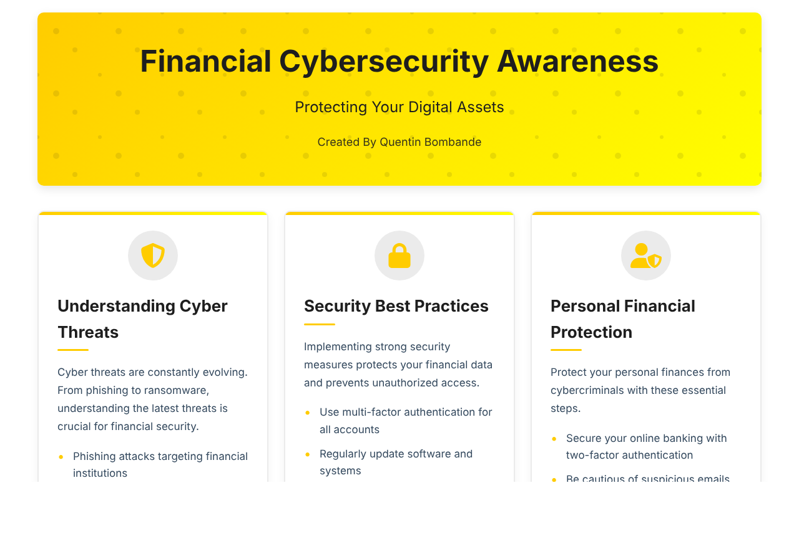

# Financial Cybersecurity Awareness

A responsive, single-page guide that explains common financial cyber threats in plain language and shows people how to protect their money, bank accounts and mobile money wallets.

**Live site:** https://quentincoding912001.github.io/financial-cyber-security/



## What it covers

- Common cyber threats, from phishing to ransomware
- Security best practices and personal financial protection
- Business security basics
- Red flags that signal fraud
- Mobile money (MoMo) safety for users in Ghana
- Compliance frameworks such as GDPR and PCI DSS
- Risk assessment tools and an emergency response plan

## Built with

- HTML5 and CSS3 (CSS Grid, custom properties, keyframe animations)
- Vanilla JavaScript
- Font Awesome icons
- Hosted on GitHub Pages

## Run it locally

No build step is needed. Clone the repo and open `index.html` in your browser.

```bash
git clone https://github.com/QuentinCoding912001/financial-cyber-security.git
cd financial-cyber-security
```

## Project structure

```
index.html    Page content
style.css     Styles
script.js     Entrance animation for the author and contact sections
docs/         Screenshot used in this README
```

## Author

**Quentin Bombande**, web developer in Accra, Ghana

[Portfolio](https://quentincoding912001.github.io/quentin-portfolio/) · [LinkedIn](https://www.linkedin.com/in/quentin-bombande-3b3965221/) · [GitHub](https://github.com/QuentinCoding912001)
